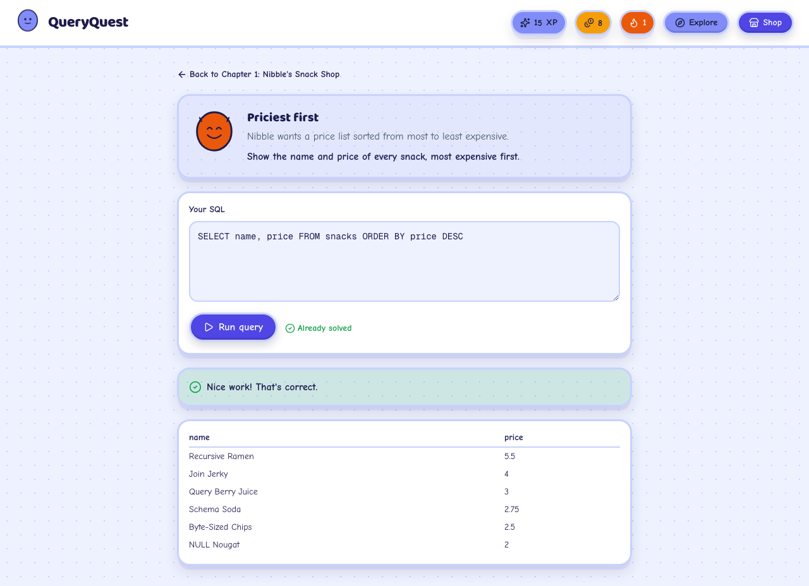
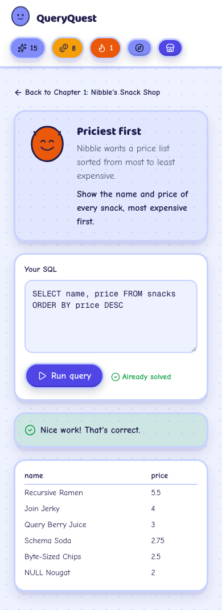
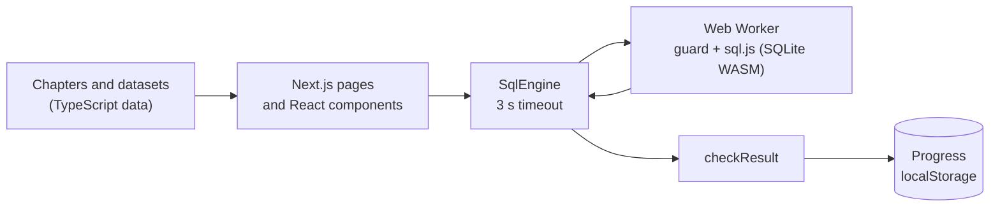

<div align="center">

# QueryQuest

**Learn SQL by playing. Story-driven challenges run real SQL in your browser, with a mascot who cheers you on.**


No accounts, no backend, no API keys. Everything runs on your device.

[What it does](#what-it-does) · [Try it](#try-it) · [Run it](#run-it) · [Architecture](#architecture) · [Engineering](#engineering-highlights) · [Verification](#verification-and-limits)

</div>

> [!IMPORTANT]
> **It has not been deployed yet.** You run it locally with `npm run dev`. Nothing here claims a live URL.
>
> **Verified in Chromium only.** The lessons have not been tested with real learners, and accessibility has not been audited ([details](docs/VERIFICATION.md)).

<p align="center"></p>

## What it does

You work through **7 chapters and 27 challenges**, each gated on the last: SELECT basics, filtering, joins, aggregation, subqueries and CTEs, window functions, then a boss case that combines them.
Every chapter opens with a short lesson (concept, syntax box, worked example). Your query runs against a real SQLite database compiled to WebAssembly, and the result is compared with the expected answer.
Correct answers earn XP and coins for a cosmetic shop. **Explore** mode lets you run any SQL on five sample datasets or on a CSV you drop in.

## Try it

| Do this | You should see |
|---|---|
| Open Chapter 1, challenge 3, run `SELECT name, price FROM snacks ORDER BY price DESC` | "Nice work! That's correct.", 6 rows starting with Recursive Ramen at 5.5, and your XP goes up |
| In the same challenge, run `DROP TABLE snacks` | "Challenges are read-only: only SELECT queries are allowed here." The challenge still works afterwards |
| Open **Explore**, pick Snack Shop, run `SELECT 'a;b' AS x` | one row, `a;b` (a semicolon inside text is fine) |
| In Explore, run `SELECT 1; SELECT 2` | "Only a single SQL statement is allowed per run." |
| In Explore, run `WITH RECURSIVE c(n) AS (SELECT 1 UNION ALL SELECT n + 1 FROM c) SELECT COUNT(*) FROM c` | after 3 seconds, "Query took too long to run and was stopped." The tab stays responsive |
| In Explore, drop a CSV with a column named `order` | it loads; use `"order"` in quotes in your queries |

<p align="center"></p>

## Run it

```bash
npm install
npm run dev        # http://localhost:3000
```

Needs Node 20 or newer. No environment variables.

```bash
npm test                   # unit tests (Vitest)
npm run build && npx playwright test    # browser tests against the production build
npm run lint
```

## Architecture



More diagrams (running a challenge, data shapes, trust boundaries): [docs/ARCHITECTURE.md](docs/ARCHITECTURE.md) and [docs/SECURITY.md](docs/SECURITY.md).

## Engineering highlights

| Concern | Implementation |
|---|---|
| Runaway queries | SQL runs in a Web Worker. No answer in 3 seconds: the worker is terminated and rebuilt. Queries over 2,000 characters are refused |
| Safe by default | Challenges are read-only (statement allowlist plus `PRAGMA query_only`, default on, re-applied before every run); worker start-up fails closed |
| Correct answers | Every challenge is checked in CI against an independent answer key run on real SQLite; float noise is tolerated in ordered and unordered checks |
| Untrusted CSV | 5 MB, 5,000 rows, 40 columns; all names double-quoted, text escaped; SQL keywords as headers work |
| Browser hardening | Content Security Policy, HSTS, `nosniff`, referrer and permissions policies; zero requests to other origins (tested) |
| Supply chain | `npm audit` clean for production; the committed WASM file is tested to match the installed sql.js build; CI fails on high advisories |
| Quality gates | ESLint, strict TypeScript, 109 unit tests, 8 browser tests, GitHub Actions on every push |

## Explore the code

- [`src/lib/sql-engine/`](src/lib/sql-engine/): [`client.ts`](src/lib/sql-engine/client.ts) (timeout and rebuild), [`sql.worker.ts`](src/lib/sql-engine/sql.worker.ts), [`guard.ts`](src/lib/sql-engine/guard.ts) (one statement, read-only allowlist)
- [`src/lib/game/`](src/lib/game/): [`chapters.ts`](src/lib/game/chapters.ts), [`checkResult.ts`](src/lib/game/checkResult.ts), [`store.ts`](src/lib/game/store.ts), [`unlock.ts`](src/lib/game/unlock.ts)
- [`src/lib/datasets/`](src/lib/datasets/): five datasets and [`csvImport.ts`](src/lib/datasets/csvImport.ts)
- [`tests/`](tests/) and [`e2e/`](e2e/): the unit and browser tests; [`tests/answers.ts`](tests/answers.ts) is the answer key
- [`docs/`](docs/): [AUDIT](docs/AUDIT.md) · [ARCHITECTURE](docs/ARCHITECTURE.md) · [SECURITY](docs/SECURITY.md) · [VERIFICATION](docs/VERIFICATION.md)

## Verification and limits

Measured on 2026-11-12 (details in [docs/VERIFICATION.md](docs/VERIFICATION.md)): **109** unit tests and **8** browser tests pass; lint and type checks are clean; `npm audit --omit=dev` reports 0 vulnerabilities.

**Not claimed:** a live deployment; support for Safari, Firefox or phones beyond a 390 px Chromium viewport; accessibility conformance; that the lessons teach well; that progress or scores are tamper-proof (they live in your browser and answers are checked there); `.xlsx` import (CSV only, because the standard library had unpatched advisories).
Seven moderate advisories remain in dev tooling (ESLint). The CSP still allows inline scripts, which Next.js needs for its bootstrap.

## License

[MIT](LICENSE). Datasets are hand-written compact versions inspired by the Chinook and Northwind teaching databases, not copies. Built with [Next.js](https://nextjs.org/), [sql.js](https://sql.js.org/), [Zustand](https://zustand-demo.pmnd.rs/), [Tailwind CSS](https://tailwindcss.com/) and [PapaParse](https://www.papaparse.com/).
