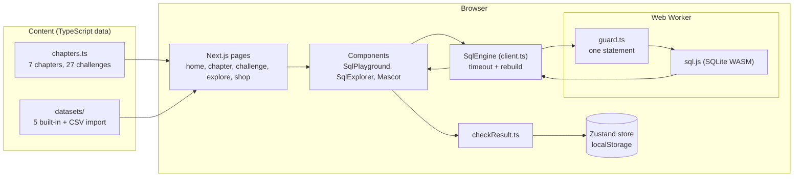
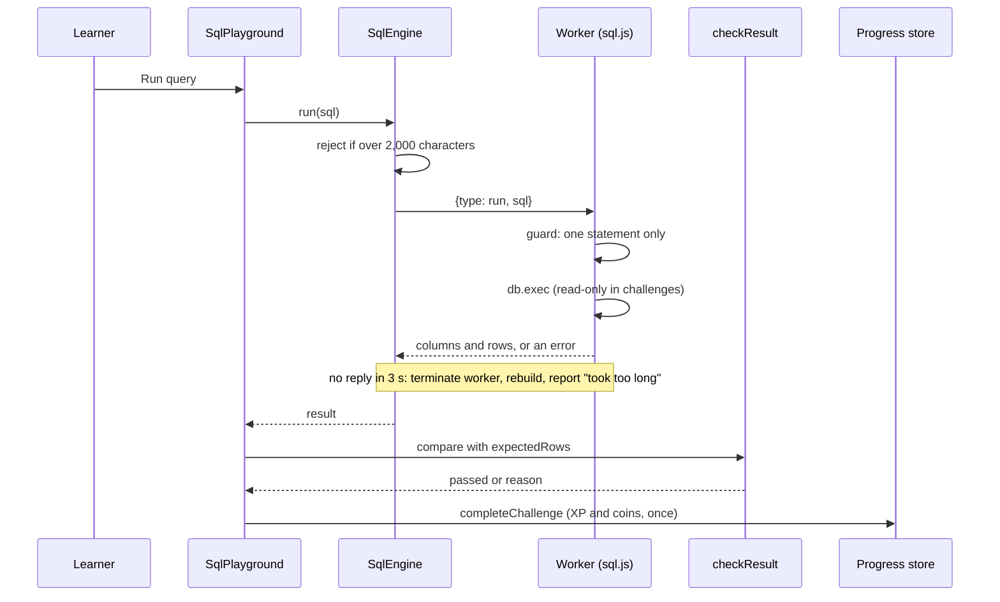

# Architecture

A static-style Next.js app. There is no backend, no database server and no account system. The "database" is SQLite compiled to WebAssembly (sql.js) running in a Web Worker in the learner's browser.

## System

## Running a challenge

## Data

| Data | Where | Shape |
|---|---|---|
| Chapters and challenges | `src/lib/game/chapters.ts` | `Chapter { id, order, seedSql, lesson, challenges[] }`, `Challenge { expectedColumns, expectedRows, orderMatters, xpReward, coinReward }` |
| Datasets | `src/lib/datasets/` | `Dataset { id, name, tables[], seedSql }`. Snack Shop, Music Store and Trading Co are hand-written compact versions inspired by Chinook and Northwind, not copies. |
| Progress | `localStorage` key `queryquest-progress` | `{ xp, coins, streak, lastPlayedDate, completedChallengeIds[], ownedItemIds[] }` |
| Answer keys | `tests/answers.ts` | one SQL string per challenge, used only by tests |

## Decisions

- **Worker plus terminate, not cooperative cancel.** sql.js runs synchronously, so the only hard limit is killing the worker. The engine rebuilds it on the next query.
- **Progress hydrates after mount.** The store uses `skipHydration` so the first client render matches the server HTML.
- **Challenge mode is read-only, Explore is not.** Challenges need stable sample data; Explore is for experimenting.
- **CSV yes, Excel no.** The standard Excel library had unpatched advisories when this was decided (see `.project-memory/DECISIONS.md`).
- **No answer keys in the shipped bundle.** Expected result sets ship (they must, to check answers in the browser); the solution SQL does not.

## Folder map

| Path | Purpose |
|---|---|
| `src/app/` | pages (App Router) |
| `src/lib/sql-engine/` | `client.ts`, `sql.worker.ts`, `guard.ts` |
| `src/lib/game/` | chapters, `checkResult.ts`, `unlock.ts`, `store.ts`, shop items |
| `src/lib/datasets/` | datasets and `csvImport.ts` |
| `src/components/` | UI |
| `tests/` | Vitest unit tests; `e2e/` Playwright tests |
