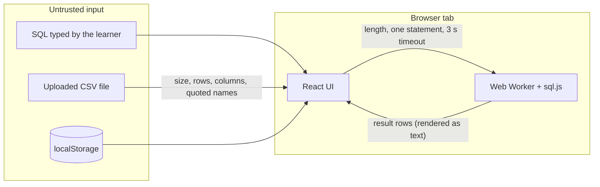

# Security

QueryQuest has no server, no accounts and no network calls of its own. Everything runs in the learner's browser. That removes most risks and leaves a few to manage.

## What is protected

| Asset | How |
|---|---|
| The learner's browser tab | SQL runs in a Web Worker. A query longer than 2,000 characters, with more than one statement, or running over 3 seconds is refused or the worker is terminated and rebuilt. |
| The sample databases | Challenge mode is read-only: only `SELECT`, `WITH` and `VALUES` may start a statement, and `PRAGMA query_only = ON` is re-applied before every run, so `PRAGMA`, `DROP`, `DELETE` and `INSERT ... RETURNING` are refused. Read-only is the default; the Explore page opts in to writes. |
| The learner's uploaded CSV | Parsed in the browser and never sent anywhere. Limits: 5 MB, 5,000 rows, 40 columns. Table and column names are double-quoted and text values are escaped, so a hostile file stays data. |
| Page integrity | Content Security Policy: same-origin only, no objects, no framing, workers from `self`. Plus `Strict-Transport-Security`, `upgrade-insecure-requests`, `nosniff`, a referrer policy and a permissions policy that denies camera, microphone and location. Workers load from `self` only (no `blob:`). |
| Dependencies | `npm audit --omit=dev` is 0 and CI fails on any high advisory. The committed `public/sql-wasm.wasm` is tested to be byte-identical to the installed sql.js build. |

## Trust boundaries

## What is not protected

- **Cheating.** Progress, XP and coins live in localStorage and answers are checked in the browser, so a learner can edit their own progress or the page's code. Read-only mode protects the sample data, not the honesty of a result. That only affects their own game.
- **A stored bad value.** Progress is not validated when loaded (see [AUDIT.md](AUDIT.md) item 11).
- **Inline scripts.** `script-src` includes `'unsafe-inline'` because Next.js inlines small bootstrap scripts. A nonce would remove that but would make every page render on demand. The app renders user data as React text and uses no `innerHTML`, `dangerouslySetInnerHTML` or `eval` (checked by search), so the exposure is small.
- **Dev tooling advisories.** 7 moderate advisories remain in the ESLint toolchain. They are not shipped.
- **Other browsers.** Tested in Chromium only.

## Privacy

No analytics, no cookies, no third-party requests at run time. Fonts are served by Next.js from the same origin at build time. Progress and uploaded CSV data stay on the device.

## Reporting

Open a private security advisory on the GitHub repository, or an issue if it is not sensitive.
